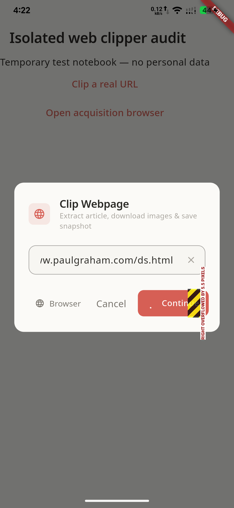
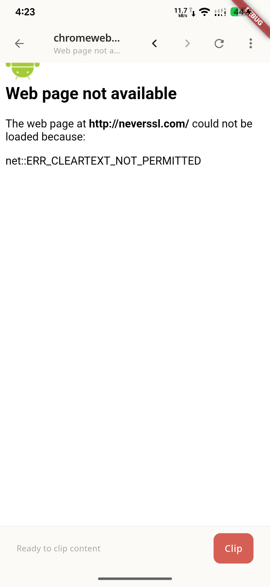

# USB device evidence

The source revision, isolation model, real-link matrix and scope are in [README.md](README.md). No article bodies or personal note data are included below. Counts refer to the exact fetched/captured representations at the time of testing; live pages can change and serve different HTML by user agent.

## Direct scans executed on the physical phone

```json
[
  {
    "key": "paulgraham",
    "testedAt": "2026-11-17T10:49:43.047753+00:00",
    "summary": {
      "url": "https://www.paulgraham.com/ds.html",
      "title": "Do Things that Don't Scale",
      "rootTag": "table",
      "rootId": "",
      "rawHeadingCount": 0,
      "cleanHeadingCount": 0,
      "rawLength": 37514,
      "cleanLength": 31703,
      "bodyTextLength": 27900,
      "cleanTextLength": 25110,
      "sourceArticleParagraphs": 0,
      "retainedParagraphs": 0,
      "fallback": false,
      "markdownLength": 82089,
      "sizes": {
        "markdown": 82173,
        "snapshot": 34045
      },
      "elapsedMs": 3012,
      "imageCount": 3
    }
  },
  {
    "key": "rfc",
    "testedAt": "2026-11-17T10:49:45.291464+00:00",
    "summary": {
      "url": "https://www.rfc-editor.org/rfc/rfc9110.html",
      "title": "RFC 9110: HTTP Semantics",
      "rootTag": "section",
      "rootId": "appendix-D",
      "rawHeadingCount": 154,
      "cleanHeadingCount": 1,
      "rawLength": 1184898,
      "cleanLength": 248738,
      "bodyTextLength": 556598,
      "cleanTextLength": 55036,
      "sourceArticleParagraphs": 0,
      "retainedParagraphs": 0,
      "fallback": false,
      "markdownLength": 90009,
      "sizes": {
        "markdown": 90484,
        "snapshot": 1189587
      },
      "elapsedMs": 1974,
      "imageCount": 0
    }
  },
  {
    "key": "nasa",
    "testedAt": "2026-11-17T10:49:48.503151+00:00",
    "summary": {
      "url": "https://science.nasa.gov/universe/stars/",
      "title": "Stars - NASA Science",
      "rootTag": "article",
      "rootId": "post-50611",
      "rawHeadingCount": 73,
      "cleanHeadingCount": 7,
      "rawLength": 301332,
      "cleanLength": 34551,
      "bodyTextLength": 29848,
      "cleanTextLength": 6760,
      "sourceArticleParagraphs": 22,
      "retainedParagraphs": 21,
      "fallback": false,
      "markdownLength": 10195,
      "sizes": {
        "markdown": 10251,
        "snapshot": 566050
      },
      "elapsedMs": 3123,
      "imageCount": 15
    }
  },
  {
    "key": "mdn",
    "testedAt": "2026-11-17T10:49:57.099785+00:00",
    "summary": {
      "url": "https://developer.mozilla.org/en-US/docs/Web/JavaScript/Reference/Global_Objects/Array/map",
      "title": "Array.prototype.map() - JavaScript",
      "rootTag": "main",
      "rootId": "content",
      "rawHeadingCount": 20,
      "cleanHeadingCount": 18,
      "rawLength": 178397,
      "cleanLength": 24860,
      "bodyTextLength": 81624,
      "cleanTextLength": 9097,
      "sourceArticleParagraphs": 35,
      "retainedParagraphs": 32,
      "fallback": false,
      "markdownLength": 15481,
      "sizes": {
        "markdown": 15489,
        "snapshot": 245082
      },
      "elapsedMs": 8484,
      "imageCount": 0
    }
  },
  {
    "key": "wikipedia",
    "testedAt": "2026-11-17T10:49:59.004832+00:00",
    "summary": {
      "url": "https://en.wikipedia.org/wiki/Flutter_(software)",
      "title": "Flutter (software)",
      "rootTag": "main",
      "rootId": "content",
      "rawHeadingCount": 6,
      "cleanHeadingCount": 4,
      "rawLength": 224061,
      "cleanLength": 151717,
      "bodyTextLength": 30772,
      "cleanTextLength": 11517,
      "sourceArticleParagraphs": 13,
      "retainedParagraphs": 13,
      "fallback": false,
      "markdownLength": 29775,
      "sizes": {
        "markdown": 29852,
        "snapshot": 450600
      },
      "elapsedMs": 1815,
      "imageCount": 1
    }
  }
]
```

## Additional direct and actual WebView captures

```json
{
  "hexo-direct-summary": {
    "url": "https://hexo.io/docs/writing.html",
    "title": "Writing",
    "rootTag": "article",
    "rootId": "",
    "rawHeadingCount": 7,
    "cleanHeadingCount": 5,
    "rawLength": 22032,
    "cleanLength": 5748,
    "bodyTextLength": 5439,
    "cleanTextLength": 2834,
    "sourceArticleParagraphs": 12,
    "retainedParagraphs": 12,
    "fallback": false,
    "markdownLength": 3537,
    "sizes": {
      "markdown": 3539,
      "snapshot": 153802
    },
    "elapsedMs": 8680,
    "imageCount": 1
  },
  "star-direct-summary": {
    "url": "https://en.wikipedia.org/wiki/Star",
    "title": "Star - Wikipedia",
    "rootTag": "main",
    "rootId": "content",
    "rawHeadingCount": 30,
    "cleanHeadingCount": 28,
    "rawLength": 1161947,
    "cleanLength": 1043131,
    "bodyTextLength": 142541,
    "cleanTextLength": 108475,
    "sourceArticleParagraphs": 119,
    "retainedParagraphs": 117,
    "fallback": false,
    "markdownLength": 216145,
    "sizes": {
      "markdown": 217196,
      "snapshot": 1525225
    },
    "elapsedMs": 8516,
    "imageCount": 27
  },
  "pg-browser-capture": {
    "url": "https://www.paulgraham.com/ds.html",
    "title": "Do Things that Don't Scale",
    "rootTag": "main",
    "rootId": "",
    "rawHeadingCount": 1,
    "cleanHeadingCount": 1,
    "rawLength": 56669,
    "cleanLength": 28315,
    "bodyTextLength": 34969,
    "cleanTextLength": 25023,
    "sourceArticleParagraphs": 1,
    "retainedParagraphs": 1,
    "fallback": false,
    "markdownLength": 26071,
    "sizes": {
      "markdown": 26101,
      "snapshot": 67873
    },
    "imageCount": 1
  },
  "hexo-browser-capture": {
    "url": "https://hexo.io/docs/writing",
    "title": "Writing",
    "rootTag": "article",
    "rootId": "",
    "rawHeadingCount": 7,
    "cleanHeadingCount": 5,
    "rawLength": 24250,
    "cleanLength": 5723,
    "bodyTextLength": 5446,
    "cleanTextLength": 2834,
    "sourceArticleParagraphs": 12,
    "retainedParagraphs": 12,
    "fallback": false,
    "markdownLength": 3507,
    "sizes": {
      "markdown": 3509,
      "snapshot": 155758
    },
    "imageCount": 1
  },
  "rfc-browser-capture": {
    "url": "https://www.rfc-editor.org/rfc/rfc9110.html",
    "title": "RFC 9110: HTTP Semantics",
    "rootTag": "section",
    "rootId": "appendix-D",
    "rawHeadingCount": 154,
    "cleanHeadingCount": 1,
    "rawLength": 1188561,
    "cleanLength": 248738,
    "bodyTextLength": 556749,
    "cleanTextLength": 55036,
    "sourceArticleParagraphs": 0,
    "retainedParagraphs": 0,
    "fallback": false,
    "markdownLength": 90009,
    "sizes": {
      "markdown": 90484,
      "snapshot": 1190388
    },
    "imageCount": 0
  }
}
```

## Content diagnostics

The Paul Graham diagnostic uses five different 50-character text samples, retaining occurrence counts rather than their actual contents. A nested layout table in the direct response repeats each sample three times. The mobile browser received different markup and did not show this duplication. Figure diagnostics compare complete code strings in the cleaned DOM with the converted Markdown. These comparisons do not guarantee code layout or location when a string appears elsewhere in metadata.

```json
{
  "paulgraham-direct-diagnostics": {
    "url": "https://www.paulgraham.com/ds.html",
    "figures": [],
    "paragraphs": [
      {
        "sampleLength": 50,
        "rawOccurrences": 1,
        "cleanOccurrences": 1,
        "markdownOccurrences": 3
      },
      {
        "sampleLength": 50,
        "rawOccurrences": 1,
        "cleanOccurrences": 1,
        "markdownOccurrences": 3
      },
      {
        "sampleLength": 50,
        "rawOccurrences": 1,
        "cleanOccurrences": 1,
        "markdownOccurrences": 3
      },
      {
        "sampleLength": 50,
        "rawOccurrences": 1,
        "cleanOccurrences": 1,
        "markdownOccurrences": 3
      },
      {
        "sampleLength": 50,
        "rawOccurrences": 1,
        "cleanOccurrences": 1,
        "markdownOccurrences": 3
      }
    ],
    "tables": 5,
    "preCount": 0,
    "rawPreCount": 0
  },
  "pg-browser-diagnostics": {
    "url": "https://www.paulgraham.com/ds.html",
    "figures": [],
    "paragraphs": [
      {
        "sampleLength": 50,
        "rawOccurrences": 1,
        "cleanOccurrences": 1,
        "markdownOccurrences": 1
      },
      {
        "sampleLength": 50,
        "rawOccurrences": 1,
        "cleanOccurrences": 1,
        "markdownOccurrences": 1
      },
      {
        "sampleLength": 50,
        "rawOccurrences": 1,
        "cleanOccurrences": 1,
        "markdownOccurrences": 1
      },
      {
        "sampleLength": 50,
        "rawOccurrences": 1,
        "cleanOccurrences": 1,
        "markdownOccurrences": 1
      },
      {
        "sampleLength": 50,
        "rawOccurrences": 1,
        "cleanOccurrences": 1,
        "markdownOccurrences": 1
      }
    ],
    "tables": 1,
    "preCount": 0,
    "rawPreCount": 0
  },
  "hexo-direct-diagnostics": {
    "url": "https://hexo.io/docs/writing.html",
    "figures": [
      {
        "codeLength": 27,
        "hasImage": false,
        "codeRetained": true,
        "textLength": 27
      },
      {
        "codeLength": 31,
        "hasImage": false,
        "codeRetained": false,
        "textLength": 31
      },
      {
        "codeLength": 29,
        "hasImage": false,
        "codeRetained": false,
        "textLength": 29
      }
    ],
    "paragraphs": [
      {
        "sampleLength": 50,
        "rawOccurrences": 1,
        "cleanOccurrences": 1,
        "markdownOccurrences": 1
      }
    ],
    "tables": 6,
    "preCount": 3,
    "rawPreCount": 3
  },
  "hexo-browser-diagnostics": {
    "url": "https://hexo.io/docs/writing",
    "figures": [
      {
        "codeLength": 27,
        "hasImage": false,
        "codeRetained": true,
        "textLength": 27
      },
      {
        "codeLength": 31,
        "hasImage": false,
        "codeRetained": false,
        "textLength": 31
      },
      {
        "codeLength": 29,
        "hasImage": false,
        "codeRetained": false,
        "textLength": 29
      }
    ],
    "paragraphs": [
      {
        "sampleLength": 50,
        "rawOccurrences": 1,
        "cleanOccurrences": 1,
        "markdownOccurrences": 1
      }
    ],
    "tables": 6,
    "preCount": 3,
    "rawPreCount": 3
  },
  "rfc-direct-diagnostics": {
    "url": "https://www.rfc-editor.org/rfc/rfc9110.html",
    "figures": [],
    "paragraphs": [],
    "tables": 0,
    "preCount": 0,
    "rawPreCount": 161
  },
  "rfc-browser-diagnostics": {
    "url": "https://www.rfc-editor.org/rfc/rfc9110.html",
    "figures": [],
    "paragraphs": [],
    "tables": 0,
    "preCount": 0,
    "rawPreCount": 161
  }
}
```

## Native UI state and navigation

These records contain state/routes only. The failure message in the later successful Hexo navigation is retained by WC-07; capture itself obtained the real Hexo page. The final RFC capture likewise succeeded while that stale error remained. WC-16 is the separate transition that marks the failed error document ready.

```json
{
  "pg-input": {
    "errors": [],
    "browser": null,
    "routes": [
      "push:/",
      "push:DialogRoute<void>"
    ]
  },
  "pg-loading-after": {
    "errors": [
      "A RenderFlex overflowed by 5.5 pixels on the right."
    ],
    "browser": null,
    "routes": [
      "pop:ModalBottomSheetRoute<Note?>",
      "push:MaterialPageRoute<dynamic>",
      "pop:MaterialPageRoute<dynamic>",
      "push:DialogRoute<void>",
      "pop:DialogRoute<void>",
      "push:DialogRoute<void>"
    ]
  },
  "pg-direct-saved": {
    "errors": [
      "A RenderFlex overflowed by 5.5 pixels on the right."
    ],
    "browser": null,
    "routes": [
      "push:/",
      "push:DialogRoute<void>",
      "pop:DialogRoute<void>",
      "push:ModalBottomSheetRoute<Note?>",
      "pop:ModalBottomSheetRoute<Note?>",
      "push:MaterialPageRoute<dynamic>"
    ]
  },
  "pg-browser-after-save": {
    "errors": [],
    "browser": {
      "url": "https://www.paulgraham.com/ds.html",
      "title": "Do Things that Don't Scale",
      "loading": "processing",
      "progress": 1.0,
      "error": null,
      "canClip": false
    },
    "routes": [
      "pop:ModalBottomSheetRoute<Note?>",
      "push:MaterialPageRoute<void>",
      "push:ModalBottomSheetRoute<Note?>",
      "pop:ModalBottomSheetRoute<Note?>",
      "push:MaterialPageRoute<dynamic>",
      "pop:MaterialPageRoute<dynamic>"
    ]
  },
  "neverssl-browser": {
    "errors": [],
    "browser": {
      "url": "chrome-error://chromewebdata/",
      "title": "Web page not available",
      "loading": "ready",
      "progress": 1.0,
      "error": "net::ERR_CLEARTEXT_NOT_PERMITTED",
      "canClip": true
    },
    "routes": [
      "pop:ModalBottomSheetRoute<Note?>",
      "push:MaterialPageRoute<void>",
      "push:ModalBottomSheetRoute<Note?>",
      "pop:ModalBottomSheetRoute<Note?>",
      "push:MaterialPageRoute<dynamic>",
      "pop:MaterialPageRoute<dynamic>"
    ]
  },
  "hexo-browser": {
    "errors": [],
    "browser": {
      "url": "https://hexo.io/docs/writing.html",
      "title": "Web page not available",
      "loading": "ready",
      "progress": 1.0,
      "error": "net::ERR_CLEARTEXT_NOT_PERMITTED",
      "canClip": true
    },
    "routes": [
      "pop:ModalBottomSheetRoute<Note?>",
      "push:MaterialPageRoute<void>",
      "push:ModalBottomSheetRoute<Note?>",
      "pop:ModalBottomSheetRoute<Note?>",
      "push:MaterialPageRoute<dynamic>",
      "pop:MaterialPageRoute<dynamic>"
    ]
  }
}
```

Final native summary:

```json
{
  "browser": {
    "url": "https://www.rfc-editor.org/rfc/rfc9110.html",
    "title": "RFC 9110: HTTP Semantics",
    "loading": "ready",
    "progress": 1.0,
    "error": "net::ERR_CLEARTEXT_NOT_PERMITTED",
    "canClip": true
  },
  "errors": [],
  "routes": [
    "pop:MaterialPageRoute<dynamic>",
    "push:DialogRoute<void>",
    "pop:DialogRoute<void>",
    "push:DialogRoute<void>",
    "pop:DialogRoute<void>",
    "push:ModalBottomSheetRoute<Note?>",
    "pop:ModalBottomSheetRoute<Note?>",
    "push:MaterialPageRoute<void>",
    "push:ModalBottomSheetRoute<Note?>",
    "pop:ModalBottomSheetRoute<Note?>",
    "push:MaterialPageRoute<dynamic>",
    "pop:MaterialPageRoute<dynamic>"
  ],
  "noteCount": 2
}
```

## Screenshots

The URL dialog’s loading state, rather than the settled preview footer, produced the 5.5px overflow:



The browser says Ready to clip content while Android displays a failed page:



## Final focused checks

The final run passes 23 existing relevant tests and four temporary characterization probes. Probe success means the observed bug is present, not fixed. The temporary executable probe was removed after archiving its source. A synthetic-font preview-overflow probe was excluded: native evidence identifies the URL dialog loading state instead. No full suite ran.

```text
00:00 +0: loading /home/dog/git/quitepaper/test/web_clipper/article_extractor_test.dart
00:00 +0: /home/dog/git/quitepaper/test/web_clipper/article_extractor_test.dart: ArticleExtractor extracts OpenGraph metadata and article content
00:00 +1: /home/dog/git/quitepaper/test/web_clipper/article_extractor_test.dart: ArticleExtractor handles fallback meta tags and title cleanup
00:00 +2: /home/dog/git/quitepaper/test/web_clipper/article_extractor_test.dart: ArticleExtractor extracts lazy loaded images with data-src
00:00 +3: loading /home/dog/git/quitepaper/test/web_clipper/html_to_markdown_converter_test.dart
00:00 +3: /home/dog/git/quitepaper/test/web_clipper/html_to_markdown_converter_test.dart: HtmlToMarkdownConverter converts headings, formatting, lists, blockquotes, and tables
00:01 +4: loading /home/dog/git/quitepaper/test/web_clipper/clipped_image_filter_test.dart
00:01 +4: /home/dog/git/quitepaper/test/web_clipper/clipped_image_filter_test.dart: ClippedImageFilter skips tiny decorative icons by dimension attributes
00:01 +5: /home/dog/git/quitepaper/test/web_clipper/clipped_image_filter_test.dart: ClippedImageFilter skips icons by CSS style dimensions and icon classes
00:01 +6: /home/dog/git/quitepaper/test/web_clipper/clipped_image_filter_test.dart: ClippedImageFilter skips images in noisy parent containers (nav, button, share-bar)
00:01 +7: /home/dog/git/quitepaper/test/web_clipper/clipped_image_filter_test.dart: ClippedImageFilter skips tracking and beacon URLs while keeping AVIF, WebP, SVG and JPEG
00:01 +8: /home/dog/git/quitepaper/test/web_clipper/clipped_image_filter_test.dart: ClippedImageFilter evaluates data URIs by payload length (skips 1x1 spacer, keeps rich diagram)
00:01 +9: /home/dog/git/quitepaper/test/web_clipper/clipped_image_filter_test.dart: ClippedImageFilter extracts best image source from <picture> with AVIF, WebP, and fallback
00:01 +10: /home/dog/git/quitepaper/test/web_clipper/clipped_image_filter_test.dart: ClippedImageFilter extracts best image from responsive srcset on  tag
00:01 +11: /home/dog/git/quitepaper/test/web_clipper/clipped_image_filter_test.dart: ClippedImageFilter isMeaningfulImageBytes skips empty bytes or tiny dimensions
00:01 +12: loading /home/dog/git/quitepaper/test/web_clipper/web_clip_preview_sheet_test.dart
00:03 +12: /home/dog/git/quitepaper/test/web_clipper/web_clip_preview_sheet_test.dart: WebClipPreviewSheet renders storage options, tag chips, and size estimate
00:04 +13: loading /home/dog/git/quitepaper/test/web_clipper/web_clip_browser_controller_test.dart
00:05 +13: /home/dog/git/quitepaper/test/web_clipper/web_clip_browser_controller_test.dart: WebClipBrowserController initializes with normalized URL and default state
00:05 +14: /home/dog/git/quitepaper/test/web_clipper/web_clip_browser_controller_test.dart: WebClipBrowserController normalizes http vs https URLs and strips www prefix from domain display
00:05 +15: /home/dog/git/quitepaper/test/web_clipper/web_clip_browser_controller_test.dart: WebClipBrowserController resetToReady restores ready state and clears transient messages
00:05 +16: /home/dog/git/quitepaper/test/web_clipper/web_clip_browser_controller_test.dart: WebClipBrowserController captureCurrentPage rejects when browser engine is not available
00:05 +17: /home/dog/git/quitepaper/test/web_clipper/web_clip_browser_controller_test.dart: WebClipBrowserController WebClipBrowserState computed properties
00:05 +18: /home/dog/git/quitepaper/test/web_clipper/web_clip_browser_controller_test.dart: WebClipBrowserController WebCapturePayload model fields and effectiveUrl
00:05 +19: /home/dog/git/quitepaper/test/web_clipper/web_clip_browser_controller_test.dart: WebClipBrowserController WebAcquisitionError toString formats message
00:06 +20: loading /home/dog/git/quitepaper/test/web_clipper/web_clip_browser_screen_test.dart
00:07 +20: /home/dog/git/quitepaper/test/web_clipper/web_clip_browser_screen_test.dart: WebClipBrowserScreen Widget Tests renders header, domain title, history buttons, and clip dock
00:08 +21: /home/dog/git/quitepaper/test/web_clipper/web_clip_browser_screen_test.dart: WebClipBrowserScreen Widget Tests tapping domain in header opens Navigate to URL dialog
00:08 +22: /home/dog/git/quitepaper/test/web_clipper/web_clip_browser_screen_test.dart: WebClipBrowserScreen Widget Tests overflow menu displays actions including Page Info, Copy URL, Reload
00:09 +23: loading /home/dog/git/quitepaper/test/web_clipper/usb_live_audit_probe_test.dart
00:09 +23: /home/dog/git/quitepaper/test/web_clipper/usb_live_audit_probe_test.dart: WC-12 nested layout tables duplicate article text
WC-12 input occurrences=1, output occurrences=3
00:10 +24: /home/dog/git/quitepaper/test/web_clipper/usb_live_audit_probe_test.dart: WC-13 readable sibling sections are discarded after choosing one section
WC-13 three sibling sections => only #largest retained and reported as article
00:10 +25: /home/dog/git/quitepaper/test/web_clipper/usb_live_audit_probe_test.dart: WC-14 figure containing protocol code loses its code
WC-14 code present in input figure, absent from converted output
00:10 +26: /home/dog/git/quitepaper/test/web_clipper/usb_live_audit_probe_test.dart: WC-15 astronomy photo is removed solely because its alt mentions stars
WC-15 same 1200x800 photo: alt mentions star => rejected, neutral alt => accepted
00:10 +27: All tests passed!
```
