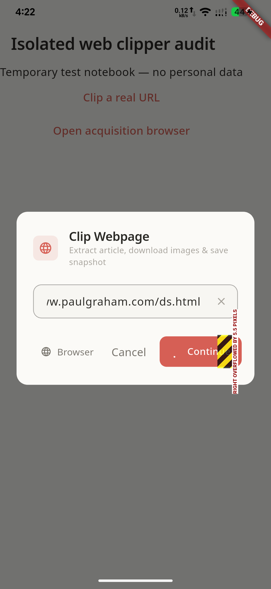

# WC-11: Continue’s loading spinner overflows the URL dialog on a phone

Status: **Fixed**. Priority: **P2**. Added during the physical-device follow-up on 2026-11-17. Application source remains `810704c40ce943d9b339279e5b83193001d32b01`.

## Impact

The URL dialog fits while idle but its Continue button extends beyond the action row when scanning starts. This clips the button edge at a normal phone width.

## Reproduction

Open https://www.paulgraham.com/ds.html through Clip Webpage on a 392.7dp-wide Android display, then tap Continue while the request is running.

**Expected:** The action row retains the button inside its available width when the loading spinner appears.

**Observed:** The Redmi K20 Pro reports a RenderFlex overflow of 5.5 logical pixels on the right during URL scanning. The native screenshot shows the overflow indicator over the Continue button. The idle dialog and settled preview footer fit.

## Evidence and cause

The outer action Row gives its nested Cancel/Continue Row unconstrained horizontal space. QuietButton adds a 16px spinner and an 8px gap while loading, increasing the minimum width. The sibling Browser action has no responsive fallback.

Physical Android UI, public URL, native touch input and screenshot. The later preview did not cause this error; the loading-state screenshot identifies the actual failing widget. No synthetic-font preview overflow is counted as an additional bug.

See [USB follow-up evidence](usb-device-follow-up/evidence.md) for numeric observations, device setup, limitations and the exact executed harness. No fix was made.

## Source locations

- [`lib/features/web_clipper/presentation/web_clip_dialog.dart:277`](../../../lib/features/web_clipper/presentation/web_clip_dialog.dart#L277)
- [`lib/core/widgets/quiet_button.dart:87`](../../../lib/core/widgets/quiet_button.dart#L87)

## Resolution

URL dialog actions wrap independently across lines when available width is insufficient, including when Continue adds a loading spinner. All actions stay within the dialog at 320, 360 and 392.7 dp.

Validation: flutter analyze: clean; 4 focused URL dialog widget tests passed. No full suite ran.
