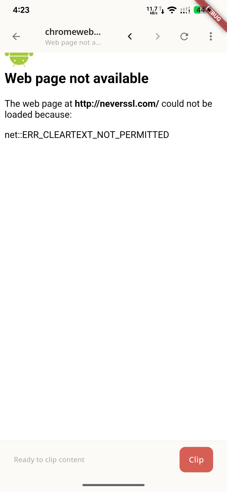

# WC-16: An Android page-load failure becomes Ready to clip

Status: **Open**. Priority: **P2**. Added during the physical-device follow-up on 2026-11-17. Application source remains `810704c40ce943d9b339279e5b83193001d32b01`.

## Impact

The acquisition browser reports success and enables Clip after the page failed to load. Its application error/retry panel disappears, and its displayed source can change to an internal Chromium error URL.

## Reproduction

Navigate the in-app browser to http://neverssl.com/ on Android, allowing the main-frame cleartext-policy failure and subsequent page-finished event to settle.

**Expected:** The browser stays in its error state and presents its retry/error controls for the failed requested page.

**Observed:** The actual device reports net::ERR_CLEARTEXT_NOT_PERMITTED but then publishes loading=ready, progress=1, canClip=true and currentUrl=chrome-error://chromewebdata/. The visible footer says Ready to clip content while the WebView displays Web page not available.

## Evidence and cause

_onResourceError sets the error state, but _onPageFinished unconditionally changes it to ready for the same generation. The readiness probe then copies window.location.href from the error document. The error panel is conditional on loadingState==error, so the page-finished callback hides it. This is separate from WC-07’s inability to clear nullable messages; it would still be wrong to mark the failed load ready after clearing the message.

Physical Android WebView, real HTTP URL, observed controller state and screenshot. The Android cleartext policy is the deterministic error trigger, not a separate reported defect and not evidence that the public site was unavailable.

See [USB follow-up evidence](usb-device-follow-up/evidence.md) for numeric observations, device setup, limitations and the exact executed harness. No fix was made.

## Source locations

- [`lib/features/web_clipper/presentation/browser/web_clip_browser_controller.dart:286`](../../../lib/features/web_clipper/presentation/browser/web_clip_browser_controller.dart#L286)
- [`lib/features/web_clipper/presentation/browser/web_clip_browser_controller.dart:304`](../../../lib/features/web_clipper/presentation/browser/web_clip_browser_controller.dart#L304)
- [`lib/features/web_clipper/presentation/browser/web_clip_browser_controller.dart:344`](../../../lib/features/web_clipper/presentation/browser/web_clip_browser_controller.dart#L344)
- [`lib/features/web_clipper/presentation/browser/web_clip_browser_screen.dart:556`](../../../lib/features/web_clipper/presentation/browser/web_clip_browser_screen.dart#L556)

